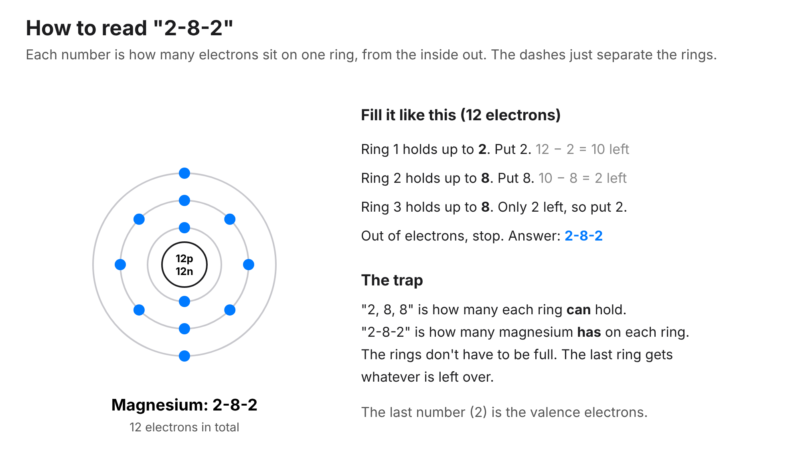
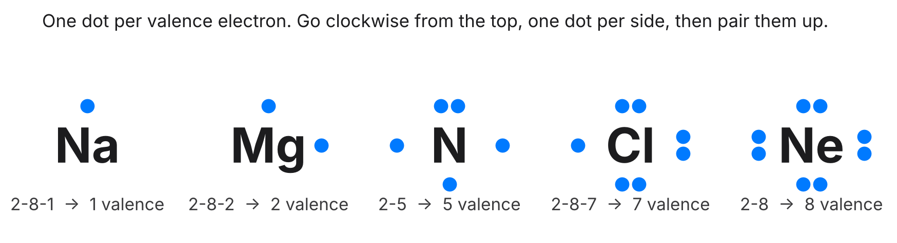
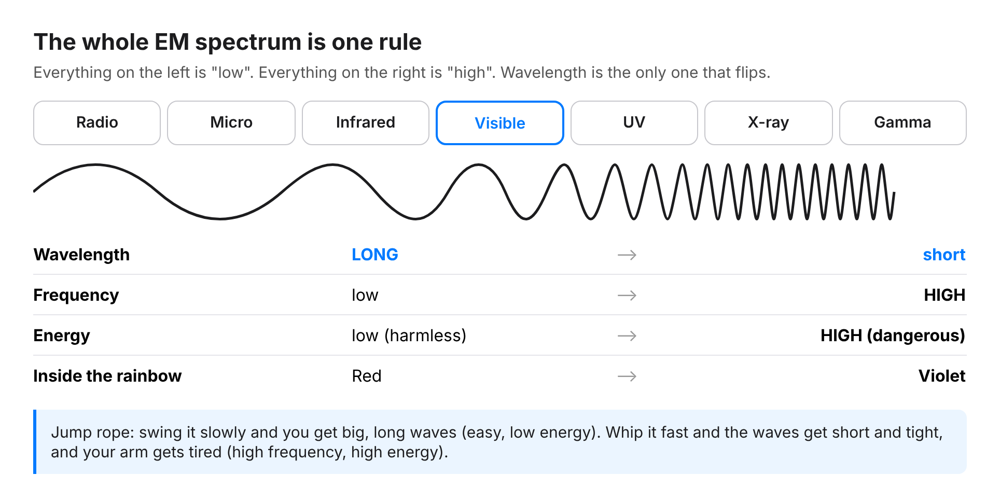
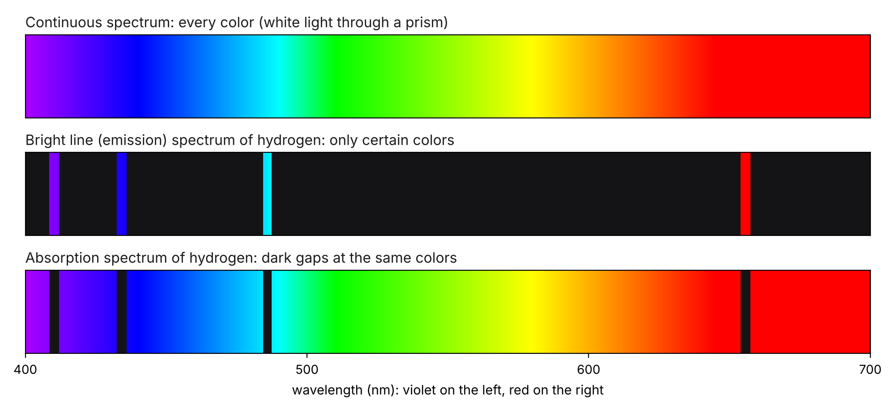
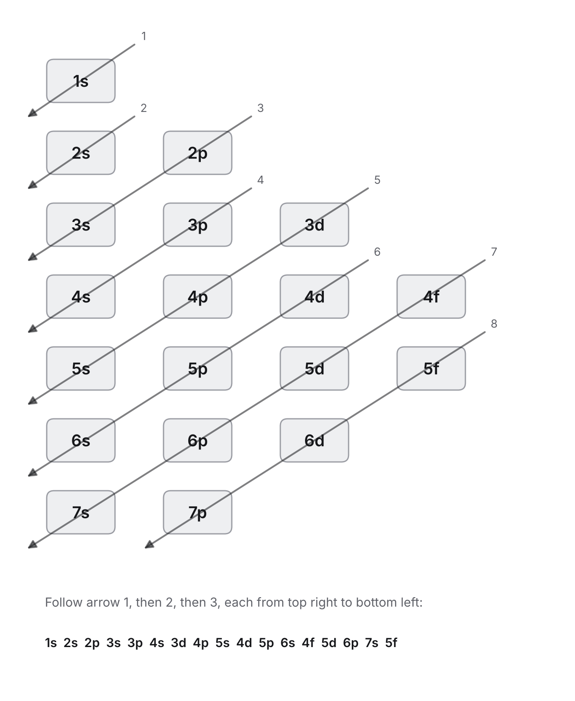
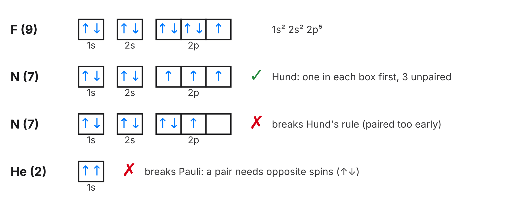

# Chemistry unit 2 study guide: atomic structure

Test: Friday, Nov 13. Written answers, with a periodic table and a calculator.

Interactive version with flashcards and practice: https://cosmeticaura.github.io/chemistry-class/unit-2/
All the code and links: https://github.com/CosmeticAura/chemistry-class

The unit has 8 topics.

## 1. Atomic theories

The models in order, and what each one added:

1. **Democritus** (about 400 BC): everything is made of tiny pieces that can't be cut, called atoms. No experiments.
2. **Dalton** (1803): atoms are solid spheres. Atoms of one element are all the same. In a reaction, atoms are only rearranged, never created or destroyed.
3. **Thomson** (1897): found the electron. Plum pudding model: negative electrons stuck in a ball of positive charge.
4. **Rutherford** (1911): gold foil experiment. Most alpha particles went straight through, so the atom is mostly **empty space**. A few bounced back, so there is a small, dense, **positive nucleus**.
5. **Bohr** (1913): electrons move in fixed **energy levels** around the nucleus.
6. **Modern (quantum) model**: electrons are in **orbitals**, regions where they are likely to be, not neat paths.

Definitions:
- **Atom:** the basic building block of matter, the smallest particle an element can be divided into.
- **Law of conservation of mass:** even though matter can change form, its total mass stays the same.

## 2. Atoms, ions and isotopes

| Particle | Charge | Mass | Where |
| --- | --- | --- | --- |
| Proton | +1 | 1 amu | Nucleus |
| Neutron | 0 | 1 amu | Nucleus |
| Electron | -1 | about 0 | Outside the nucleus |

- **Protons** = atomic number. The number of protons decides the element.
- **Neutrons** = mass number minus atomic number.
- **Electrons** = protons in a neutral atom.
- **Ion:** an atom that gained or lost electrons. Lost electrons makes it positive, gained makes it negative. Only electrons change.
- **Isotopes:** same element (same protons), different numbers of neutrons, so a different mass. Carbon-12 and carbon-14 both have 6 protons, but 6 and 8 neutrons.

Worked example: iron-56 as Fe³⁺ has 26 protons, 56 minus 26 = 30 neutrons, and 26 minus 3 = 23 electrons. Chlorine-37 as Cl⁻ has 17 protons, 20 neutrons, 18 electrons.

## 3. Average atomic mass

The mass on the periodic table is an average of all the isotopes, weighted by how common each one is.

1. Turn each percent into a decimal (60.11% becomes 0.6011).
2. Multiply each isotope's mass by its decimal.
3. Add the results.
4. The answer lands between the isotope masses, closer to the more common one.

Example, gallium: (0.6011 × 68.926) + (0.3989 × 70.925) = 41.431 + 28.292 = **69.72 amu**.

Without math: if an element's isotopes are 10 and 11 and the average is 10.81, the 11 isotope is more common because the average is closer to 11.

## 4. Bohr's model and dot diagrams

The numbers like **2-8-2** are not one big number. Read them as "2 on ring 1, 8 on ring 2, 2 on ring 3". The dashes just separate the rings.

There are two lists, and mixing them up is the most common mistake:
- **What each ring can hold:** 2, then 8, then 8. This never changes.
- **What an atom has:** depends on how many electrons it has. Fill ring 1, then ring 2, and the last ring gets whatever is left over. The last ring doesn't have to be full.

Example, magnesium (12 electrons): ring 1 takes 2 (10 left), ring 2 takes 8 (2 left), ring 3 gets the last 2. So magnesium is **2-8-2**, not 2-8-8. The nucleus has 12 protons and 12 neutrons (Mg-24).

More: potassium (19) is 2-8-8-1, chlorine (17) is 2-8-7. The last number is the **valence electrons**.

Bohr got right that electrons sit in set energy levels and give off light when they drop down, which explained hydrogen's bright line spectrum. It was replaced because it only worked for hydrogen and electrons don't move in circles.

**Dot diagrams** show only the valence electrons:
1. Find the valence electrons (the last ring number).
2. Write the element's symbol.
3. Put one dot on each side, clockwise from the top: top, right, bottom, left.
4. After all four sides have one, go around again and pair them. Never more than 8.

Sulfur (2-8-6) gets 6 dots: pairs on top and right, single dots on bottom and left. Potassium gets 1 dot on top.

## 5. Electromagnetic spectra

Definitions:
- **Electromagnetic spectrum:** the amount of light given off by an object at a range of wavelengths.
- **Bright line spectrum:** an electron can absorb or emit specific amounts of energy by changing energy levels.

The whole spectrum follows one rule. From left to right: **Radio, Microwave, Infrared, Visible, Ultraviolet, X-ray, Gamma** (Raging Martians Invaded Venus Using X-ray Guns).

| | Radio side | Gamma side |
| --- | --- | --- |
| Wavelength | Long | Short |
| Frequency | Low | High |
| Energy | Low | High |

- **Wavelength:** distance from one wave peak to the next.
- **Frequency:** how many waves pass a point each second.
- Wavelength and frequency are opposites. Energy goes with frequency.
- Inside visible light (ROYGBIV), **red** is the long wave, low energy end and **violet** is the short wave, high energy end. So green has more energy and a higher frequency than red, and red has the longer wavelength.

Three kinds of spectra:

- **Continuous:** every color, no gaps (white light through a prism).
- **Bright line (emission):** a few bright colored lines on a black background.
- **Absorption:** a rainbow with dark lines where a gas soaked up those colors.

Each element has its own spacing of energy levels, so it gives off its own set of lines, like a fingerprint.

## 6. Ground state vs excited state

- **Ground state:** every electron in the lowest level it can be in. Chlorine 2-8-7 and potassium 2-8-8-1 are ground state.
- **Excited state:** an electron absorbed energy and jumped up. The sign is an inner ring that isn't full while an outer ring has electrons, like magnesium 2-7-3 or sulfur 2-8-5-1.
- When the electron falls back down it **releases** energy as light of one exact color. A bigger drop (4 to 2) gives off more energy than a smaller one (3 to 2).

## 7. Electron configuration

Follow each arrow from its top right end to its bottom left end, arrow 1 first. That gives the order orbitals fill: 1s, 2s, 2p, 3s, 3p, 4s, 3d, 4p, 5s, 4d, 5p. Superscripts add up to the number of electrons.

- Phosphorus (15): 1s² 2s² 2p⁶ 3s² 3p³
- Selenium (34): 1s² 2s² 2p⁶ 3s² 3p⁶ 4s² 3d¹⁰ 4p⁴
- **Noble gas notation:** start with the noble gas before the element in brackets. Fe is [Ar] 4s² 3d⁶.
- **Ions of transition metals:** take electrons from 4s first. Fe²⁺ is [Ar] 3d⁶.
- Copper is an exception: [Ar] 4s¹ 3d¹⁰.
- **Valence electrons** are everything in the highest level. Selenium ends 4s² 4p⁴, so it has 2 + 4 = **6**.

The three rules:
| Rule | What it says | How to remember |
| --- | --- | --- |
| Aufbau | Fill the lowest energy orbital first | Aufbau is German for building up, so build from the bottom |
| Pauli | At most 2 electrons per orbital, spinning opposite ways (↑↓) | Pauli = pair |
| Hund | One electron in each box of a sublevel before pairing any | Bus seats: everyone takes an empty seat before sharing |

## 8. Orbital diagrams

Each box is one orbital and each arrow is one electron, so a box holds up to 2 arrows (↑↓).

In the picture: fluorine has 5 electrons in 2p, so two full boxes and one half full. Nitrogen done right puts its three 2p electrons in three separate boxes (Hund's rule). The wrong nitrogen crams two into one box while a box sits empty. The wrong helium has two arrows pointing the same way, which breaks Pauli.

| Sublevel | Orbitals (boxes) | Most electrons | Shape |
| --- | --- | --- | --- |
| s | 1 | 2 | Sphere |
| p | 3 | 6 | Dumbbell |
| d | 5 | 10 | Cloverleaf |
| f | 7 | 14 | Complex |

Nitrogen three ways:
- Configuration: 1s² 2s² 2p³
- Noble gas: [He] 2s² 2p³
- Orbital diagram: 1s ↑↓, 2s ↑↓, 2p ↑ ↑ ↑ (3 unpaired electrons)

If someone draws oxygen's 2p as ↑↓ ↑↓ with an empty box, they broke **Hund's rule**. It should be ↑↓ ↑ ↑.

## Study tip

25 minutes of studying, then a 5 minute break. Repeat. Short breaks help the brain hold on to what you just learned.
